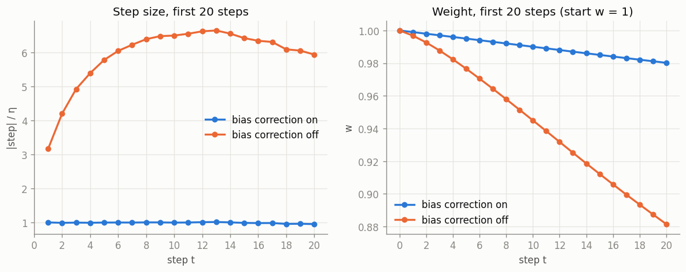
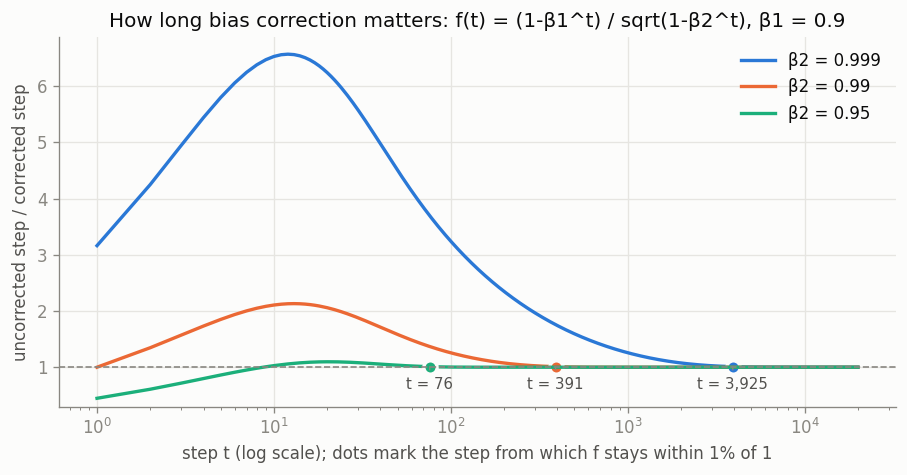
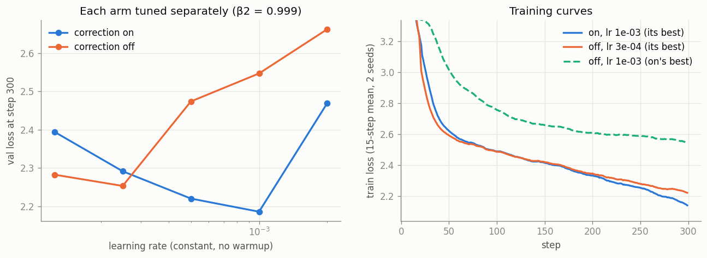
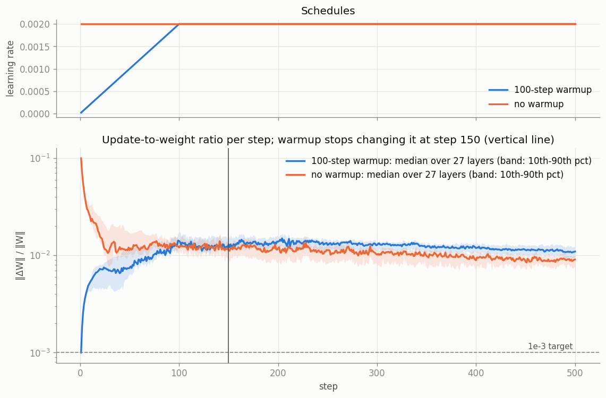
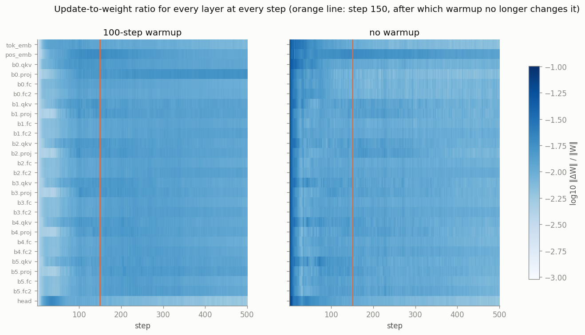
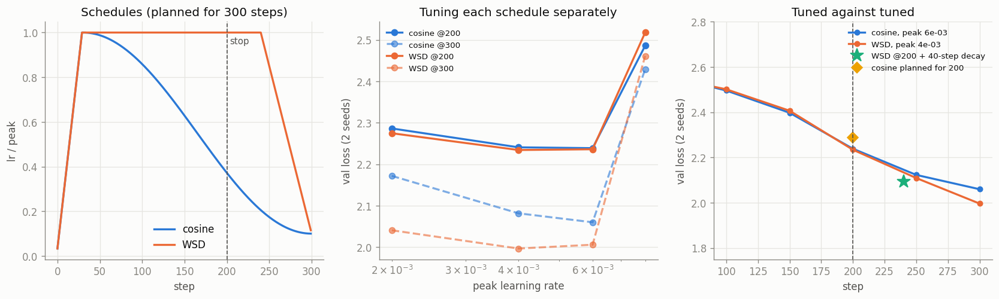
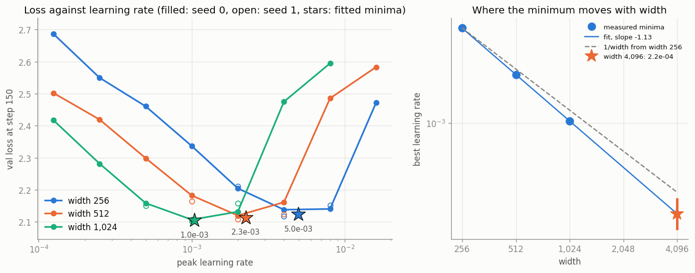

# ERA V5 · Session 11 · Optimizers and Learning-Rate Schedules

Session 10 left `optimizer.step()` unexplained. This repo opens it up on the same small character-level GPT that Session 10 trained on Tiny Shakespeare, and answers the five assignment questions with measurements. Every number below comes from one end-to-end execution of [`optimizers_and_schedules.ipynb`](optimizers_and_schedules.ipynb), whose printed tables and plots are all saved inside it.

**The rule applied to every comparison:** *tune both sides before accepting a comparison.* Bias correction on/off and cosine/WSD each get their **own** learning-rate sweep, over several seeds with identical data order, and are compared tuned against tuned. Section 2 shows why this matters: an untuned comparison overstated the gap there by more than 5×.

| | |
|---|---|
| Model (§1–§4) | the Session 10 model: pre-LN decoder-only transformer, 6 layers, 6 heads, width 192, context 128, 65-character vocab, **2,719,104 weights**, init std 0.02, dropout 0 |
| Model (§5) | same block, 2 layers, head size 64, context 64, standard parameterization (`std = 1/sqrt(fan_in)`), widths 256 / 512 / 1,024 (1.6M / 6.4M / 25.5M weights) |
| Data | Tiny Shakespeare, 1.1M characters, 90/10 split; validation loss always on the same 65,536 held-out characters |
| Optimizer | AdamW, decoupled weight decay 0.1 on matrices and embeddings, none on LayerNorm scales and biases, gradient clipping at 1.0 |
| Hardware | one NVIDIA GeForce GTX 1660 Ti laptop GPU (6 GB), fp32. It runs at ~86 °C and throttles under sustained load, which is why the sweeps are sized as they are. The whole notebook ran in **79.5 min** |

## Headline answers

| # | Question | Result |
|---|---|---|
| 1 | Adam by hand vs PyTorch | `m`, `v`, `m̂`, `v̂`, step and `w` agree **exactly** in fp64 (largest gap 4.8e-17) and to 7+ decimals in fp32 ([§1](#1-adam-by-hand-checked-against-pytorch)) |
| 2 | Bias correction off | The uncorrected step is 3.16× at step 1, 6.57× at step 12 and still 6.24× at step 20. **It stops mattering after ~3,900 steps** at β2 = 0.999 (within 1%), or 76 steps at β2 = 0.95. Tuned against tuned, the 300-step loss gap is 0.067 ([§2](#2-bias-correction-switched-off)) |
| 3 | Update-to-weight ratio, per layer | **Warmup stops changing it at step ~150** (layer median 154, middle half 138 to 184), 50 steps after the ramp ends ([§3](#3-update-to-weight-ratio-per-layer)) |
| 4 | Cosine vs WSD, both stopped at 200 | **2.2388 vs 2.2343**: a tie. **Keep WSD.** Its checkpoint decays to 2.093 in 40 more steps ([§4](#4-cosine-against-wsd-stopped-at-step-200)) |
| 5 | LR sweep at widths 256 / 512 / 1,024 | Minima **5.0e-3 / 2.3e-3 / 1.0e-3** (slope −1.13). **Use 2e-4 at width 4,096**, moderately confident in the scale (≈70% within 1.5e-4 to 3e-4) ([§5](#5-learning-rate-sweep-across-widths)) |

---

## 1. Adam by hand, checked against PyTorch

One weight starting at `w = 1`, the five gradients from §6 of the session notes, `η = 0.001`, `β1 = 0.9`, `β2 = 0.999`, `ε = 1e-8`. The by-hand side is plain Python arithmetic, one line per equation:

```
m = β1·m + (1-β1)·g        v = β2·v + (1-β2)·g²
m̂ = m / (1-β1^t)           v̂ = v / (1-β2^t)          step = -η · m̂ / (sqrt(v̂) + ε)
```

The PyTorch side is `torch.optim.Adam` on a one-element parameter. `m` and `v` are read out of its state (`exp_avg`, `exp_avg_sq`), and the step is the change in the parameter.

| t | g | m | v | m̂ | v̂ | step | w |
|---|---|---|---|---|---|---|---|
| 1 | 0.50 | 0.0500 | 0.000250 | 0.5000 | 0.2500 | −0.001000 | 0.999000 |
| 2 | 0.40 | 0.0850 | 0.000410 | 0.4474 | 0.2050 | −0.000988 | 0.998012 |
| 3 | 0.60 | 0.1365 | 0.000769 | 0.5037 | 0.2567 | −0.000994 | 0.997018 |
| 4 | 0.45 | 0.1678 | 0.000971 | 0.4881 | 0.2431 | −0.000990 | 0.996028 |
| 5 | 0.55 | 0.2061 | 0.001273 | 0.5032 | 0.2550 | −0.000996 | 0.995031 |

Largest |hand − PyTorch| over the five steps:

| quantity | `Adam` fp64 | `AdamW(wd=0)` fp64 | `Adam` fp32 |
|---|---|---|---|
| m | 0 | 0 | 2.6e-9 |
| v | 0 | 0 | 7.2e-11 |
| m̂ | 0 | 0 | 7.7e-9 |
| v̂ | 0 | 0 | 2.2e-8 |
| step | 4.8e-17 | 4.8e-17 | 1.4e-8 |
| w | 0 | 0 | 1.3e-8 |

The table reproduces §6 of the notes exactly. In fp64 PyTorch and the hand computation agree to round-off, 16 decimal places on the step and exactly on everything else. In fp32 they agree to 7 to 10 decimals, which is fp32's own resolution. The gradients range from 0.40 to 0.60, yet every step is within 1.2% of η.

## 2. Bias correction switched off

Without correction, `m = m̂·(1−β1^t)` and `v = v̂·(1−β2^t)`, so the uncorrected step is the corrected one times

```
f(t) = (1 − β1^t) / sqrt(1 − β2^t)
```

which **does not depend on the gradients at all**. The notebook confirms this: its measured OFF/ON ratio equals `f(t)` at all 20 steps.



At step 1 the factor is `0.1 / 0.0316 = 3.16`, the number in the notes. It rises to **6.57× at step 12** and is still **6.24× at step 20**. After twenty steps the uncorrected weight has moved 6× as far (to 0.881, against 0.980). Twenty steps are nowhere near enough for the two to agree, so the factor is followed until it settles:



| β2 | f(1) | max f (at step) | within 10% from | within 5% from | within 1% from |
|---|---|---|---|---|---|
| **0.999** (default) | 3.16 | 6.57 (12) | 1,751 | 2,375 | **3,925** |
| 0.99 | 1.00 | 2.13 (13) | 175 | 237 | 391 |
| 0.95 (Session 10 / V5) | 0.45 | 1.10 (20) | 6 | 43 | **76** |

**Answer: with the default β2 = 0.999 the difference stops mattering after about 3,900 steps** (within 1%). It takes that long because `v` averages over ~1,000 steps and needs several of those spans to fill. The `m` side alone would settle in ~44 steps. With V5's β2 = 0.95 the difference is gone by step 76. There the uncorrected first step is even *smaller* than η (0.45×), which acts as a tiny built-in warmup.

**In real training**, the Session 10 model was trained for 300 steps with β2 = 0.999 and **no warmup**, so that bias correction alone protects the first steps. Both arms use a hand-written `ManualAdamW` with a `bias_correction` switch. With the switch on, it matches `torch.optim.AdamW` to 1.7e-5 after 10 steps, the same as PyTorch against itself run twice (1.2e-5, GPU round-off). Each arm is swept over 5 learning rates × 2 seeds.



| lr | val loss, correction ON | val loss, correction OFF |
|---|---|---|
| 1.25e-4 | 2.394 | 2.282 |
| 2.5e-4 | 2.291 | **2.253** |
| 5e-4 | 2.220 | 2.474 |
| 1e-3 | **2.185** | 2.547 |
| 2e-3 | 2.469 | 2.662 |

Tuned against tuned, correction off loses **0.067** (2.253 vs 2.185, about 10× the seed spread), and the training curves are still 3.8% apart at step 300, as the 3,900-step answer predicts. Compared at the ON arm's learning rate, the gap would have looked like **0.36**. In practice, turning correction off acts mostly as a learning-rate multiplier, and the off side needs a ~4× smaller nominal rate. The first version of this sweep used a narrower grid, and the off side's best value sat on its edge. It had to be widened before the comparison could be accepted, which is the session's rule in action.

## 3. Update-to-weight ratio, per layer

`‖ΔW‖ / ‖W‖` was logged after **every** step for all 27 weight matrices: the token and position embeddings, `qkv`, `proj`, `fc` and `fc2` in each of 6 blocks, and the head. There are two 500-step runs, identical except for the schedule: peak η = 2e-3 (Session 10's tuned value), β = (0.9, 0.95), with or without a 100-step linear warmup, and constant afterwards.





**How the step is identified.** After step 100 both runs use the same learning rate. Per layer, the quotient `r_warmup / r_no-warmup` (15-step centred smoothing) measures warmup's effect. The reported step is the first one after which this quotient stays within 15% of its settled level (its median over steps 200 to 500).

**Answer: warmup stops changing the ratio at about step 150.**
- **Layer-median ratio:** the quotient settles at **step 150**. Per layer, the median is **step 154**, the middle half of the layers fall between 138 and 184, and the full range is 83 to 201.
- **The warmup run on its own:** its ratio has flattened by step 82, at 1.23e-2. The extra 50 to 70 steps are the no-warmup run still settling down from its start.
- **Afterwards warmup leaves a constant offset, not zero.** The warmup run's ratio stays **~1.22× higher**, because the no-warmup run inflated its weights in its first steps. The exceptions are the head (0.92×), the position embeddings (0.87×) and `b0.proj` (2.27×).
- **The first step is the session's argument at our scale.** Adam's first step moves every weight by η = 2e-3, against weights initialised at 0.02. So without warmup **every layer's ratio is 0.10 at step 1**, 100× the 1e-3 guideline. With warmup the largest ratio anywhere is **0.021** (the head, at step 35).
- **Why the early steps are large:** the ratio per unit of learning rate is 50 at step 1 in both runs (all gradients agree). It drops to 26 with warmup or 13 without by step 10, and to ~6 to 7 by step 50 as the gradients decorrelate. Warmup keeps η small through exactly those steps.
- **Loss at step 500:** 1.883 with warmup, against 2.153 without.

Caveat: after warmup the ratio sits near 1e-2 here, 10× the session's 1e-3 target. This tiny model tolerates it over a short run. On a V5-sized run, a ratio held at 1e-2 would be a reason to lower η.

## 4. Cosine against WSD, stopped at step 200

Both schedules are planned for **300 steps** with a 30-step warmup and end at 10% of peak:
- **cosine** decays from step 30;
- **WSD** stays flat until step 240, then decays linearly over the last 20%.

Both are stopped at step 200. Each schedule's peak learning rate was tuned **separately** (4 values × 2 seeds, the same data order for both schedules), selected on the 300-step loss the run was planned for. Picking on the step-200 loss instead chooses the same values.



| peak lr | cosine @200 | cosine @300 | WSD @200 | WSD @300 |
|---|---|---|---|---|
| 2e-3 | 2.2864 | 2.1719 | 2.2748 | 2.0405 |
| 4e-3 | 2.2408 | 2.0815 | **2.2343** | **1.9965** |
| 6e-3 | **2.2388** | **2.0599** | 2.2361 | 2.0057 |
| 8e-3 | 2.4861 | 2.4295 | 2.5179 | 2.4615 |

| model | val loss (2 seeds) |
|---|---|
| **cosine stopped at 200** (peak 6e-3) | **2.2388** ± 0.006 |
| **WSD stopped at 200** (peak 4e-3) | **2.2343** ± 0.022 |
| WSD step-200 checkpoint + 40-step decay | 2.0928 ± 0.002 |
| cosine planned for 200 steps from the start | 2.2884 ± 0.014 |
| cosine run to 300 | 2.0599 |
| WSD run to 300 | 1.9965 |

**Answer.** At step 200 the two are **tied**: 2.2388 against 2.2343, well inside the seed noise, with per-seed paired differences of +0.012 and −0.021.

**I would keep the WSD model.** Its step-200 weights sit on the flat part of the schedule, so they are a checkpoint that can still be finished. Resuming it (weights, optimizer moments and data position) and decaying over 40 more steps gives **2.093**, which is 0.146 better than the cosine model and better than a cosine run planned for 200 steps. The cosine model has already spent most of its decay (its learning rate is at 37% of peak, on a curve tied to a 300-step plan) and has no sensible way to continue. Even with zero extra steps the two models are equal, and WSD keeps the option open. That is the session's reason for choosing WSD for V5. WSD also wins the full 300-step run, 1.997 against 2.060.

**One result went against the notes.** A cosine schedule planned for 200 steps (2.288) did *worse* than the 300-step cosine stopped at 200 (2.239). This model is far from converged at 200 steps (loss falling ~0.1 per 50 steps), and in that regime loss follows the total learning rate spent, which the shorter cosine cuts. The notes' claim is about runs near the end of their useful length; this one isn't.

## 5. Learning-rate sweep across widths

Standard parameterization with one learning rate for every weight, 2 layers, head size 64, AdamW (0.9, 0.95), weight decay 0.1, 150 steps with a 15-step warmup and cosine decay to 10%, context 64. Eight learning rates a factor of 2 apart were run at every width (seed 0), with a second seed at the best point and its two neighbours. Rates more than 0.1 worse twice in a row were not extended further. Each minimum comes from a parabola fitted in `log2(lr)` to the two-seed mean at those three points.



| lr | width 256 | width 512 | width 1,024 |
|---|---|---|---|
| 1.25e-4 | 2.686 | 2.502 | 2.417 |
| 2.5e-4 | 2.550 | 2.419 | 2.282 |
| 5e-4 | 2.460 | 2.299 | 2.158 / 2.151 |
| 1e-3 | 2.337 | 2.182 / 2.164 | **2.107 / 2.103** |
| 2e-3 | 2.205 / 2.211 | **2.120 / 2.109** | 2.132 / 2.158 |
| 4e-3 | **2.138 / 2.118** | 2.161 / 2.124 | 2.475 |
| 8e-3 | 2.140 / 2.152 | 2.485 | 2.595 |
| 1.6e-2 | 2.472 | 2.583 | (skipped) |

| width | fitted minimum | per-seed fits | loss at minimum |
|---|---|---|---|
| 256 | **4.97e-3** | 5.5e-3, 4.7e-3 | 2.123 |
| 512 | **2.26e-3** | 2.1e-3, 2.4e-3 | 2.113 |
| 1,024 | **1.04e-3** | 1.1e-3, 9.8e-4 | 2.105 |

The best rate falls by ~2.2× per doubling of width. The log-log slope is **−1.13**, close to the −1 that §12 of the notes gives for the standard parameterization.

**Answer: at width 4,096 I would use 2e-4.**
- **Where the number comes from:** the fitted line gives 2.2e-4. Refitting on every combination of per-seed minima gives 1.7e-4 to 2.8e-4. The plain 1/width rule from the width-1,024 minimum gives 2.6e-4.
- **Why round down:** the loss rises much more steeply above the minimum than below it. At width 1,024, 4× too high costs 0.37 in loss, while 4× too low costs 0.18. The fitted slope is also a little steeper than −1.
- **A cross-check:** the value matches the 1.9e-4 in the session's table for width 4,096.

**Confidence: moderate on the scale, low on the exact value.** I'd put about 70% on the true optimum, for this recipe, lying between 1.5e-4 and 3e-4. The reasons for caution:
- It extrapolates 4× beyond the widest model measured, from three points with two seeds near each minimum, on a factor-of-2 grid.
- The proxy is 2 layers, context 64 and 150 steps. Short runs prefer larger rates, so a long run's optimum is probably a bit lower still.

Before spending a real run on it, I would do a three-point check at width 4,096 (1e-4, 2e-4, 4e-4), or switch to muP, where a sweep at width 256 transfers directly. That is the open "spend a day on a muP sweep" decision in §14 of the notes.

---

## Files

| Path | What it is |
|---|---|
| [`optimizers_and_schedules.ipynb`](optimizers_and_schedules.ipynb) | the executed notebook, every output saved |
| [`optimizers_and_schedules.py`](optimizers_and_schedules.py) | the same notebook as plain source (jupytext "percent" format) |
| [`tools/run_notebook.py`](tools/run_notebook.py) | builds and executes the notebook from the source, capturing prints and figures |
| [`results.json`](results.json) | every headline number from the run |
| [`logs/update_ratio.npz`](logs/update_ratio.npz) | the full per-layer, per-step update-to-weight ratios for both §3 runs |
| [`plots/`](plots) | every figure, as PNG |
| [`data/input.txt`](data/input.txt) | Tiny Shakespeare |

## Reproducing

```bash
pip install -r requirements.txt
python tools/run_notebook.py
```

This regenerates `optimizers_and_schedules.ipynb`, `results.json`, `logs/` and `plots/`. The notebook also runs top to bottom in Jupyter or VS Code. The runner exists because the Python environment with CUDA PyTorch on this machine has no Jupyter kernel installed. Seeds are fixed, but the GPU's attention backward pass is not bit-deterministic, so re-runs differ in the third or fourth decimal of the losses. The fp64 checks in §1 are exact.
